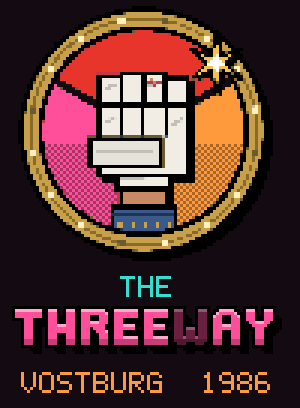
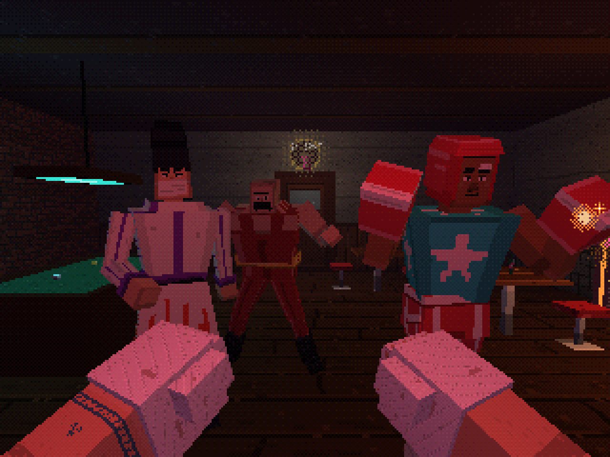
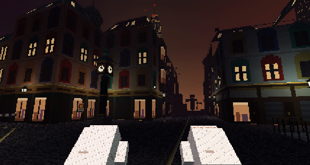

# The Threeway



VR beat 'em up prototype for Quest 3. Vostburg, 1986: a city split three ways by a cold war, and the one bar where all three sides drink together. The officials want it shut. Their muscle just walked in.

This is the combat MVP. It answers one question: does hitting people in The Threeway feel good?



## Play

- **Quest 3:** open the GitHub Pages URL for this repo in the Quest browser and press **Enter VR**.
- **Desktop:** serve the folder over HTTPS or localhost (`npx serve .`) and press **Fight on desktop**. Desktop mode is for testing without a headset.
- **Skip ahead:** pick a level under **Start at** on the menu (or open the page with `?level=street` or `?level=superblock`).

| Quest 3 | Action |
| --- | --- |
| Swing for real | Hand speed sets the hit: under 1.5 m/s shove, 1.5–3 light, 3–5 solid, 5+ heavy. Needs 20 cm of travel, so wrist flicks do nothing |
| Both forearms in front of your face | Block |
| Duck or lean | Dodge (every attack is telegraphed: a glowing fist and a grunt) |
| Hit the swinging arm late in the windup | Parry: hard stagger |
| Grip | Grab a bottle, a stool or a goon's collar |
| Release mid-swing | Throw (thrown goons curve toward other goons) |
| Bottle to your mouth | Drink to heal |
| Wrestler clinch | Punch his arms twice or headbutt him |
| Left stick / right stick | Move / snap turn 30° |
| Grip as a potato or pot reaches you | Catch it, then throw it back |
| Swat the bat (or the bat arm) mid-swing | Disarm Bat Boy; the bat drops and is yours |
| Left X | Perf + tuning panel on your left wrist (left stick: up/down picks, left/right changes) |
| A | Restart after clearing a level (or walk on: out the bar's open door, through the lifted boom) |

Desktop: mouse look, WASD, left/right click (or J/K) punch, Shift heavy, hold X light, Space block, C duck, G headbutt, E grab/drop/catch, Q throw, F drink, R restart, P perf panel (`[` `]` pick a setting, `-` `=` change it).

## What's in

- **Physics-first goons.** Every goon is an active ragdoll: 15 joint particles held together by sticks (position-based dynamics, 120 Hz). Standing, they're pulled toward their animation, so every hit physically shoves them at the spot you hit and they spring back. Knockdowns, launches and throws drop the pull and they go limp, then get up onto a knee and stand. Grab a collar and the rest of the body dangles from your fist. Thrown goons bowl over other goons and scatter the bar stools; slamming them into walls or the bar hurts.
- **Real scale.** Goons are 1.71–1.77 m; Rocco and Ivan are 1.83–1.91 m. Your body is a capsule nobody can walk or punch through, so goons stop at arm's length instead of ending up inside your face.
- **Props are physical too:** bottles and stools tumble, get kicked around by goons, knocked off the bar by your fists, and bottles shatter on hard impacts.
- The Threeway bar in the art spec's PS1 look: vertex-lit, ≤16-colour hand-pixeled textures, 6-bit colour with a soft 4×4 Bayer dither, plum fog, 6 per-vertex lights, fine vertex snap (a slight wobble). Desktop also renders 240 lines with affine warp; VR keeps snap but turns affine off.
- Velocity punching with the four tiers, 40–60 ms hitstop on the enemy (never the player's view), haptics.
- Hidden poise per enemy: flinch → stagger (bonus-damage window) → knockdown → launch. Head hits do more damage, body hits more poise.
- Forearm block, parry, dodge by moving your head.
- Grab and throw, bottles (one hit, drinkable) and stools (three hits).
- Bōsōzoku punk (fodder), Columbian boxer (fast jab combos, high guard: go to the body), Krasnovian wrestler (clinches you).
- **Bat Boy** (Columbia, weapon goon): a long, telegraphed overhead bat swing. The bat is a real physics prop pinned to his wrist. Block it with your forearms, or swat the bat or his bat arm mid-swing to knock it loose. Then pick it up: it adds 10 damage and swings 1.3× faster than your fist.
- **The cook** (Krasnovia, thrower): keeps 3–5 m away and lobs potatoes and pots on real ballistic arcs aimed at your head. Block them with a forearm, dodge, punch them away, or squeeze grip as one arrives to catch it and throw it back. Thrown props curve slightly toward a goon in front of you.
- **Aoki Security** (Hinomoto, shield): a company guard in a black suit and a riot helmet with a mirrored visor, carrying a clear riot shield and a baton. The shield takes anything to his front (head, body, the shield arm) and punching it earns you a quick baton counter. Get around to his side, or break the shield: heavy hits and props chip it faster, and when it shatters he staggers. He strafes to keep it on you.
- **The neon kicker** (Hinomoto, fast): a street kickboxer in a neon-piped bomber who dashes in, throws a two-kick combo, then darts back out of reach. High kicks are blocked by a normal guard. Low kicks (a LOW! sign over the chambered knee) go under it: drop a forearm to belly height or step back.
- **Rocco & Ivan** (round 4 mini-boss): Rocco is a broad Columbian bouncer who fights like a faster boxer (four-punch combos, high guard). Ivan is a Krasnovian bouncer in a tracksuit who clinches harder and needs three arm hits to break. One fights while the other circles wide. Stagger, floor or grab the active one and his partner tags in. Drop one for good and the survivor enrages: faster and with shorter windups. Both have health bars over their heads.
- Attack tokens (two attackers at once, the rest circle), four escalating rounds: punk + kicker → Aoki Security + boxer + Bat Boy → cook + wrestler + kicker + Bat Boy + punk → Rocco & Ivan.

## Level 2: out the door



Clear the bar and the front door swings open onto **Tripoint Square** at night. Walk out and the street starts.

- **The square:** Old Quarter tenements (plaster, Krasnovian painted window surrounds, Columbian cast-iron shopfronts, Hinomoto tile roofs) under green-copper and slate roofs, lit by pale gaslight. The Brass Clock (1888), sealed Tripoint Station, St. Vost Cathedral's onion domes over the roofs. Three brass lines in the setts (the Accords borders) meet at the Threeway's door. The Threeway's front: pink neon and all three flags over the door. The other two old roads are barricaded by the militia.
- **The fight:** three stretches: the square (punks and a kicker from the side roads), the old road (boxer, Bat Boy, the cook), and the last stretch before the checkpoint (Aoki Security, the wrestler, a kicker). Each stretch holds you in until it's clear; go down and you restart that stretch at full health.
- **Street props:** crates (break after two hits), bins (never break) and cast-iron street signs (swing long, like the bat). Grab, swing, throw.
- **The end:** the joint-militia checkpoint: booth, floodlight, the Free City's flag with the three powers'. Walk up to the boom and it lifts. The Ring Road and the Accords wall start beyond it.
- **The skylines:** Hinomoto's black-glass neon cluster behind the Threeway (Aoki Development tallest, an expressway of tail lights), Krasnovia's even field of panel slabs, the Tower of Labor and the TV tower right of the road, Columbia's ridge of cream-and-gold deco towers left of it. Red beacons blink on top. The sky glows red, sodium and gold over each sector.

## Act 1, level 3: the Krasnovian gate and Superblock 14

Clear the road and the checkpoint boom lifts. Keep walking: there's no cut and no loading. Across the Ring Road, the Accords wall runs on down the old road's line. Krasnovia is the lane to its right.

- **The gate:** a concrete wall across the Krasnovian lane, a gantry with KRASNOVIAN UNION in cream on red, a sentry box, a floodlight, red flags. The Columbian lane beyond the wall is shut with an iron gate. Conscripts hold the gate, and a laborer comes from the forecourt.
- **The forecourt and the arch:** sodium lamps, a worker mosaic and a banner on a nine-storey panel slab. You go in through the arch under it.
- **Superblock 14's courtyard:** twelve-storey wings with lit kitchens and TV-blue windows, lock-up garages along the Accords wall (its watchtower behind them), packed dirt, a rocket climbing frame, swings, a sandpit, benches, laundry on the line, a parked saloon. Two fights: the courtyard (a laborer, conscripts, the cook) and the door (the wrestler, two laborers, a conscript).
- **Podezd 3:** the 22-storey point block's door, its stairwell windows lit all the way up. Walk up to it and the level ends; the stairwell is next.
- **Krasnovian goons only:** the **conscript** (fodder: an oversized greatcoat, a fur ushanka, half asleep, slow windups) and the **laborer** (a steel pipe swung like Bat Boy's bat but slower and heavier; swat it loose and it's yours, and it never breaks), plus the wrestler and the cook.

## Act 1, level 4: podezd 3 (inside Superblock 14)

There are no stairs anywhere (VR): lifts and a cradle do the climbing, so your view only moves up or down in an enclosed or eased ride.

- **The lobby:** through the street door from the courtyard. Mailboxes, a radiator, the stairs padlocked shut. A fight with the door shut behind you.
- **Lift A** climbs once the lobby is clear and **breaks at the 7th**: sparks, the doors jam half open, and it's dead from then on.
- **The 7th:** fight on the landing, then through the party wall into the **north wing's corridor**: padded doors, bare bulbs, laundry, a communal kitchen halfway along. A corridor fight with the cook, a laborer, the wrestler and a conscript.
- **Lift B** at the far end takes you to **the wing's roof**, 34 m up, with the 22-storey point block towering beside you and the whole city around. A roof fight.
- **The cradle:** step into the window-cleaner's cradle and it lowers you down the north face to the railway bank. The Palace of Sport is next.

## Act 1, level 5: the Palace of Sport

Still one flat floor all the way, no cut from the railway bank.

- **The level crossing:** through a gap in the railway fence. The barriers are down, the lamps wig-wag, the bells ring, and the evening electric (four green cars) comes out of the tunnel under the wall and thunders past. Then the barriers lift.
- **The Boulevard of Champions:** paving between clipped poplars, benches, sodium lamps, a bronze-ish champion on a plinth holding up a gilt wreath, the Palace's drum lit up ahead. A fight (sambo, conscripts, a laborer).
- **The forecourt and the foyer:** flagpoles, the Bear on the hoardings, PALACE OF SPORT over a glass front. Inside: ticket windows, the trophy cabinet, Volkov's posters.
- **The gym:** wall bars, mats, a vaulting horse, a beam, rings, a barbell rack. A fight (gymnasts, a lifter, sambo) that holds you in.
- **The arena:** out of the players' tunnel onto the sports floor, the stands full on all four sides, slogan boards, banners, a lighting truss, the scoreboard (VOLKOV 9 : GUEST 0), the ring under its lamps. **Bogdan "the Bear" Volkov** in the ring: boss bar, enrages at half health.
- **The north doors:** shut behind a steel shutter until he's down; then out onto Parade Square.

The old Tram Depot 7 level is gone (it stood where the Palace's grounds are now). Its paintings stay in `src/depot/paint.js`: the Palace and the railway reuse them.

## Act 1, level 6: Parade Square

Out of the Palace of Sport's north doors, no cut: the May Day parade's rehearsal at night, under floodlights. One flat floor.

- **The square:** granite paving with the red route running from the Palace's doors to the Tower of Labor's, faded red banners on poles down both sides, four floodlight masts throwing warm pools on the four fight zones, sodium lamps at the edges. Three portrait floats on wheeled platforms (invented heroic workers: a steelworker, a woman in a kerchief, a miner), the brass band's drums, chairs and music stands, the gymnasts' mats with a vaulting horse and a beam, empty bleachers on the east side under PEACE · LABOR · UNITY. Floats, the stand, the band's gear and the masts are solid, so fights go around them.
- **The Ministry of Order** (Inspector Orlova's) on the west side: a grey stepped block, red banners, a shut bronze portico, a gold cog, and one lit window high up with someone standing in it, watching. Not enterable.
- **The reviewing stand** at the north end: two draped wings with canopies (GLORY TO LABOR, 1 MAY 1986) either side of the Tower's doors, flags and floods on the poles between them.
- **Three fights** (the Palace's doors shut behind you while each is on): the honour guard (two guards with flagpoles, two conscripts), the gymnasts (three gymnasts and a laborer, on and around the mats), the band (two bandsmen throwing cymbals and drumsticks, the specialist out of the Tower's doors, a guard, a conscript). Goons not built yet stand in (`ENEMY_FALLBACK` in `src/levels.js`).
- **The end:** walk up to the Tower of Labor's doors. The Tower is next.

## Act 1, level 7: the Tower of Labor

Through the Tower's big south doors from Parade Square, no cut. Krasnovia's seat of power: a stepped palace of floodlit stone (four tiers, gilt bands, banners, TOWER OF LABOR over the doors) under a tapering spire with a gilded cog at ~210 m and the Krasnovian beacon on top. The cog stands that high so it clears Superblock 14's point block, which sits right on the line from Tripoint Square to the Tower. No stairs: three enclosed, eased lifts do the climbing, each shut while its floor's fight is on.

- **The lobby:** marble, a red carpet, four columns, a giant worker mosaic (an invented steelworker and harvester holding up a gold cog) behind a bronze statue of a steelworker raising a cog, flags, banners. Ministry militia and inspectors; the doors are shut behind you while it's on.
- **Lift 1 to the Ministry's office floor:** rows of desks and typewriters, filing cabinets, a wall of invented ministers' portraits under LABOR · ORDER. Clerks and a bodyguard.
- **Lift 2 to the archive:** steel shelving full of files, the card index, Inspector Vera Orlova's desk. Orlova (boss bar; enrages at half health) and her bodyguard.
- **Lift 3 to the Chairman's office, under the cog:** oak panelling, a huge desk, flags, his portrait, and a panoramic window over the night city. The Chairman is no fighter, but he has a boss bar. Beat him and he signs the permit to reopen The Threeway: SIGNED · 1 OF 3, the permit lies on his desk, ACT 1 COMPLETE. (A leader goon with `signs: true` calls `onLeaderSigned(e)`; until the Chairman's own goon lands, beating the last fight counts as his signature.)


## Quest performance

- **Merged static geometry.** The whole bar room is one mesh on one atlas (`tools/bar_atlas.py` packs its textures; the shader tiles each texture inside its box of the atlas). The street is one mesh on a painted, mipmapped atlas, the skylines and far city another. Light is **baked per vertex** at build time with the shader's own formula, so any number of gas lamps is free; goons, props and hands are lit live by the 6 nearest lamps (the bar's six inside).
- **Prop batches.** Every stool, crate, bin and street sign is written into one mesh per material each frame (a few hundred vertices on the CPU), so a room full of stools or a street full of crates is one draw call.
- **LOD stand-ins.** Past the Old Quarter's edge every building is one cheap box with its lit windows painted on, always drawn, out to ~400 m: you see the city's lights and rooflines all the way to the skylines, nothing pops. The street atlas is mipmapped (wrapped gutters), so far things average instead of sparkling.
- **Portal culling.** The world is rooms joined by doorways (`src/rooms.js`): you're in one room, and a neighbour is drawn only if the doorway into it is open and in view (and the room beyond that only if its doorway is too). The bar and the street only draw each other through the open door; inside with the door shut, the street, skylines and sky aren't drawn at all. The levels' insides (podezd 3, the Palace) work the same way.
- Measured in Chromium: 9 draw calls in the bar (was 26), 8–9 down the street, 18 looking back at the Threeway through its open door (was 49). ~52k static triangles, most of them the always-on skylines and far city.
- **One draw call per goon.** Each goon is a single CPU-skinned mesh: every body part's vertices are moved by its ragdoll frame each frame, and the hurt/KO faces swap by rewriting the face UVs. Previously each goon was 14 to 16 draw calls. Stools are one mesh on a vinyl + chrome atlas.
- **Perf panel.** Left X (desktop: P) shows fps, physics ms per frame, draw calls and the current quality level on your left wrist, plus live tuning for ragdoll pull, hit shove, knockback, fist pitch in the controller and vertex snap. Tuning is saved in the browser.
- **Auto quality.** If the frame rate stays under 90% of the 72 Hz target for 1.5 s, physics steps down (120 Hz × 4 iterations → 90×4 → 90×3 → 72×3 → 60×2). It steps back up after sustained headroom, and backs off further each time it has to drop again. Turn it off in the panel.
- Damage feedback is a red dithered vignette, haptics and sound. The camera never moves on its own.

## Tuning

Every number lives in `CFG` in `src/config.js` (level 2: `CFG.street`: the stretches, triggers, spawns and arenas, street props, gaslight, fog, sky glow; the levels after the street: `CFG.superblock`, `CFG.podezd`, and `CFG.palace` etc. in each level's own file; Volkov himself is in `CFG.enemies.volkov`): physics (`CFG.physics`: how hard goons follow their animation, hit shoves, personal space, domino and impact speeds), tier thresholds, damage and poise per tier, hitstop, knockback, magnetism, block and dodge distances, grab and throw, weapons and projectiles, per-enemy stats, the boss tag team (`CFG.boss`), waves, perf/auto quality (`CFG.perf`), render settings (desktop lines, VR framebuffer scale, snap/affine per mode), and `hands.modelPitchDeg` for how the fist model sits in the controller.

## Tests

No headset needed. The tests run the real game script against a small stand-in for Three.js (math and scene graph only, no rendering):

```
node test/street.js    # 41 checks: one-mesh bar room, prop batches, LOD stand-ins, portal culling, the door opens and leads outside, walls and crossings, baked light and the live lights outside/inside, the stretches (trigger, spawn, arena lock, clear, lose + restart), the boom, crates/bins/signs, draw calls + triangle budget, street physics cost
node test/floors.js     # 29 checks: raised floors, ramps and stairs (a test staircase): the bar unchanged bit for bit, easing up a flight, landing edges, goons fighting, falling and getting up on a landing, props on floors
node test/podezd.js     # 30 checks: in from the courtyard (no cut), the lobby, lift A breaks at the 7th, the landing, the link, the corridor fight, lift B, the roof (respawn on the roof), the cradle down; rides smooth (mm per frame), goons on their floors, rooms, physics cost
node test/parade.js     # 48 checks: one baked mesh + triangle budget, nothing from the far city on it, west of x -6, the Tower's doorway left open, flat floor, out of the Palace's doors with no cut (a stub Palace if it isn't there), walls (the Palace's front, the ministry, the bleachers, the Tower's front) and solid floats/stand/drums/masts, the three fights in order (arena both ways, doors shut), restart after going down, the Tower's doors end it, hand-over with no jump, physics cost
node test/superblock.js  # 29 checks: past the boom with no cut, one baked mesh + triangle budget, nothing from the skylines on it, the gate/arch/slabs/garages as walls, Krasnovian-only fights in order, restart a stretch, the door ends the level, physics cost
node test/palace.js     # 30 checks: off the cradle through the fence gap (no cut), the crossing shut, the train out of the tunnel and past, the barriers up, the boulevard fight, the glass front as a wall, the gym fight (held in), Volkov (boss bar, the stands as walls, the shutter, lose + restart, enrage), out the north doors, rooms, physics cost
node test/tower.js      # 44 checks: from the menu, the shell + floors + budgets, nothing from the skylines on its ground, the old distant tower gone and the beacon on the spire, the cog clears the point block, every fight on one floor, the four fights in order (doors and lifts shut mid-fight), the three lifts (smooth: < 60 mm a frame), respawn on the right floor, Orlova's enrage, the Chairman signs (the hook too), rooms (inside, the city isn't drawn; out of his window it is), in from Parade Square with no cut, physics cost
node test/bot.js 1 400 --mode=aggro --level=street   # the bot fights down the street to the checkpoint (--level=both: the bar, out the door, then the street; --level=superblock: the gate and the courtyard; --level=road: the street, through the boom, on into Superblock 14)
node test/vr.js        # 56 checks: the laborer's pipe (disarm, pick up), the conscript, level 2 in VR (start outside, stick walking, held in by the stretch), tiers, flick, block, parry, clinch, grab/throw, drink, perf panel + tuning, potato catch + throw-back, bat disarm + bat damage, riot shield block/counter/flank/shatter, high vs low kicks + retreat, locomotion
node test/physics.js   # 47 checks: heights for all 9 goons, skinned mesh vs skeleton, one mesh per goon/stool, shove + recover, launch, get-up, dominoes, the cook's lob accuracy, Rocco & Ivan tag + enrage
node test/bot.js 1 400 --mode=aggro    # a bot plays all four rounds (catches pots, throws them back); prints hits, losses, catches, tags, per-round times, errors
```

They check game logic only. Rendering, shaders and real WebXR need a browser or the headset.

## Stack

Three.js r149 from jsDelivr, WebXR, synthesized placeholder audio. Plain script files, no build step: `index.html` loads them in order and they share one global scope, so it runs straight off GitHub Pages or any static server (not from `file://`: browsers won't load the textures there).

| File | What's in it |
| --- | --- |
| `src/config.js` | `CFG`: every tunable number |
| `src/textures.js`, `assets/tex/` | texture names → hand-pixeled PNGs |
| `src/render.js` | renderer, scene, the PS1 shader (vertex snap, affine UVs, 6-bit dither, fog, baked light, atlases), lights |
| `src/geometry.js` | mesh builders, static batching, light baking |
| `src/bar.js`, `src/bar_atlas.js` | the bar room (one mesh on one atlas: `tools/bar_atlas.py`), walkable areas, the door |
| `src/street/` | level 2: `paint.js` (painted street atlas), `build.js` (the square, the road, the checkpoint), `skylines.js` (the three sectors, the far city, the sky), `fight.js` (stretches, portals, signs) |
| `src/kras/` | Krasnovia: `paint.js` (stairwell paint, padded doors, the lift; the Palace's drum, crowd, sports floor, the train), `podezd.js` (podezd 3: the lobby, the 7th, the wing's corridor and roof, two lifts, the cradle, the railway bank), `palace.js` (the Palace of Sport: the level crossing and the train, the boulevard, the foyer, the gym, the arena, `CFG.palace`), `parade.js` + `parade_paint.js` (Parade Square: the square, the Ministry of Order, the reviewing stand, `CFG.parade`), `tower.js` + `tower_paint.js` (the Tower of Labor: the shell and spire, the lobby, the office floor, the archive, the Chairman's office, three lifts, the signing, `CFG.tower`) |
| `src/superblock/` | Act 1's walk into Krasnovia: `paint.js` (slabs, garages, the gate's signs, in the street atlas), `build.js` (the gate, the forecourt, the arch, Superblock 14's courtyard and podezd 3; one baked mesh) |
| `src/depot/` | `paint.js`: paintings from the scrapped depot level (track, canvas, ropes, the Bear's poster…), still used |
| `src/rooms.js` | rooms + portals: what's drawn from where |
| `src/characters.js` | goon bodies and poses, the player's hands |
| `src/audio.js`, `src/fx.js` | placeholder sound, sprites and signs |
| `src/player.js`, `src/locomotion.js` | the player, XR + desktop input, hand/head tracking, moving and turning |
| `src/physics.js` | the particle ragdoll solver, walls, collisions |
| `src/props.js` | bottles, stools, bats, kitchenware, crates, bins, signs; prop batches |
| `src/enemies.js`, `src/combat.js`, `src/bosses.js` | goon AI, your hits, Rocco & Ivan |
| `src/game.js`, `src/hud.js`, `src/main.js` | rounds, HUD + perf panel, the frame loop and boot |
