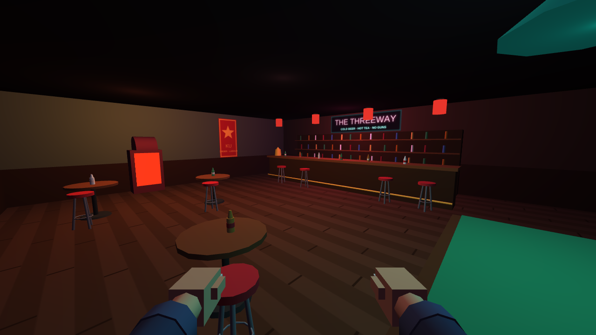

# The Threeway

VR beat 'em up prototype for Quest 3. Vostburg, 1986: a city split between three powers, and the one bar where all of them drink together. The officials want it closed. Their muscle just walked in.

This is the combat MVP: one room, three rounds, three enemy types. The question it answers is whether hitting people in The Threeway feels good.

## Play

- **Quest 3:** open the GitHub Pages URL for this repo in the Quest browser and press **Enter VR**.
- **Desktop:** open `index.html` from any HTTPS host (or `npx serve .`) and press **Fight on desktop**. Desktop mode exists for testing without a headset.

| Quest 3 | Action |
| --- | --- |
| Swing | Hand speed sets damage; wrist flicks do nothing |
| Both forearms in front of face | Block |
| Duck or step aside | Dodge a glowing fist |
| Hit hard during a windup | Parry |
| Grip | Grab bottles, stools or a goon's collar |
| Release mid-swing | Throw |
| Bottle to mouth | Drink to heal |
| Left / right stick | Move / snap turn |

Desktop: mouse look, WASD, left/right click (or K/J) to punch, Shift for heavy, Space block, C duck, E grab/throw, F drink.

## Tuning

All numbers live at the top of the script in `index.html`: `CFG` (punch speed tiers, damage, poise, hitstop, knockback, throw assist), `TYPES` (per-enemy stats) and `WAVES`.

## Stack

Single file, Three.js r149 from jsDelivr, WebXR, synthesized audio. No build step.
